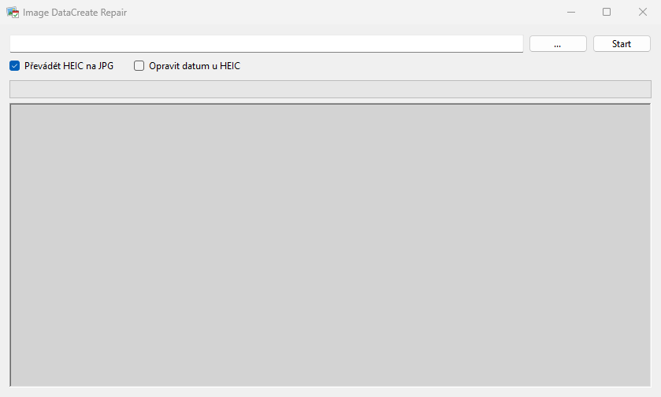

# ImageDateCreateRepair

Windows aplikace, která nastaví **datum změny** souborů fotek (JPG/JPEG, volitelně HEIC) podle data pořízení z EXIF. Hodí se pro fotky zkopírované z telefonu nebo cloudu, kde soubory nesou datum kopírování místo data pořízení, takže se špatně řadí v Průzkumníku a galeriích.



## Požadavky

- Windows 10/11 x64
- [.NET 8 Desktop Runtime](https://dotnet.microsoft.com/download/dotnet/8.0) (položka „.NET Desktop Runtime“ pro Windows x64)

## Použití

1. Spusťte `ImageDateCreateRepair.exe`.
2. Tlačítkem `...` vyberte složku s fotkami.
3. Zvolte volby (viz níže) a klikněte na **Start**.
4. Průběh a souhrn se vypisují do logu (zeleně opravené soubory, žlutě varování, červeně chyby).

> ⚠️ **Před spuštěním si složku zálohujte.** Aplikace soubory přesouvá do podsložek a při konverzi vytváří nové JPG. Zpracovává se jen vybraná složka, podsložky ne.

### Volby

| Volba | Výchozí | Popis |
|---|---|---|
| Převádět HEIC na JPG | zapnuto | Každý `.heic` převede na `.jpg` (kvalita 95). Originál přesune do `_heic`. Pokud JPG se stejným názvem už existuje, konverze se přeskočí. |
| Opravit datum u HEIC | vypnuto | Nastaví datum změny i samotným HEIC souborům. |

### Jak zpracování probíhá

1. **Fáze 1 – HEIC:** konverze a/nebo oprava data podle zvolených voleb.
2. **Fáze 2 – JPG/JPEG:** z EXIF načte `DateTimeOriginal`, a když chybí, použije `DateTime`. Toto datum nastaví jako datum změny souboru. Soubory bez EXIF data se jen zalogují.
3. **Fáze 3 – ostatní soubory:** vše kromě `.jpg`, `.jpeg` a `.heic` přesune do `_notsupport`.

### Vytvářené složky

| Složka | Obsah |
|---|---|
| `_heic` | Originály HEIC po úspěšné konverzi na JPG |
| `_notsupport` | Soubory nepodporovaných typů (videa, PNG, dokumenty …) |

Obě složky vzniknou ve vybrané složce. Soubor, který už v cílové složce existuje, se nepřepisuje.

## Sestavení ze zdrojů

Potřebujete .NET SDK 8 nebo novější.

```
dotnet publish DateCreateRepair2.csproj -c Release
```

Výsledný jediný soubor najdete v `bin\Release\net8.0-windows\win-x64\publish\ImageDateCreateRepair.exe`.

Použité knihovny: [MetadataExtractor](https://github.com/drewnoakes/metadata-extractor-dotnet) (čtení EXIF) a [Magick.NET](https://github.com/dlemstra/Magick.NET) (konverze HEIC).

## Licence

[MIT](LICENSE)
